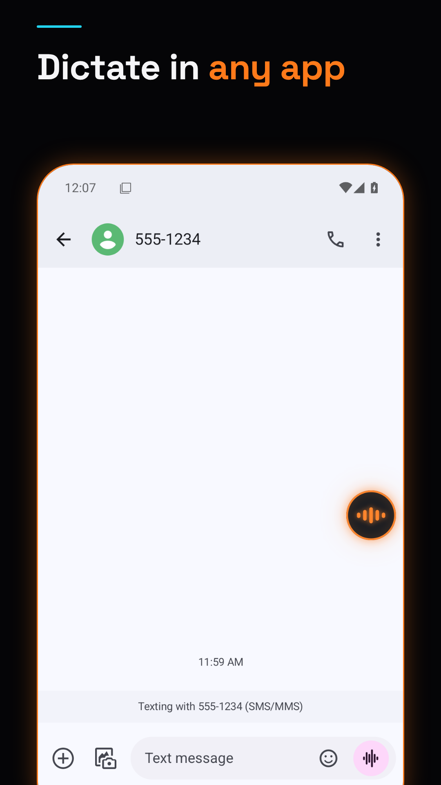
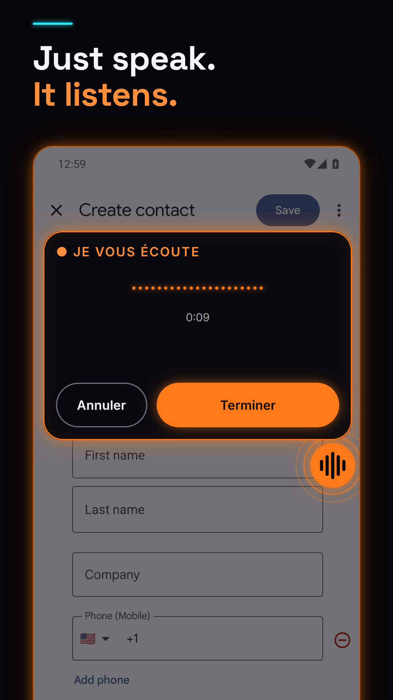
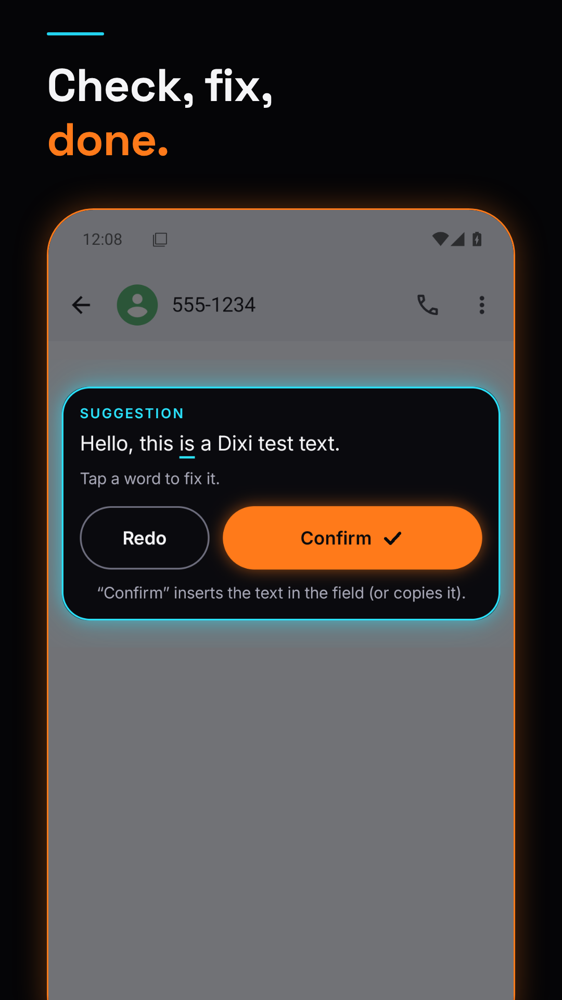
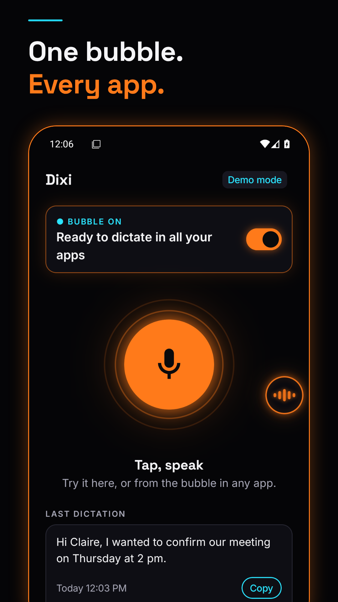

# Dixi

Voice dictation for Android. A floating bubble: tap it, speak, and the transcribed text is ready to paste in any app.

[Website](https://mickadoua.github.io/dixi/) · [Project page on dm-consulting.tech](https://www.dm-consulting.tech/en/open-source/dixi) · [Apache-2.0](LICENSE)

<p>
  
  
  
  
</p>

## What it does

- A bubble floats above your other apps. Hide it with one gesture; an edge strip or a notification brings it back.
- Tap, speak (up to 5 minutes per dictation), then confirm the suggested text. Tap a word to fix it. The text is copied.
- The text is tidied: punctuation, paragraphs, filler words removed. The meaning does not change.
- French or English, detected automatically or set in the settings.
- History of the last 20 dictations, text only. Clear it whenever you want.
- No account.

## Your own Mistral key

Transcription is done by Mistral (Voxtral model). You create your own API key at [console.mistral.ai](https://console.mistral.ai) and paste it in the settings. The key stays encrypted on your phone (Android Keystore) and is never in this repository or in the APK. Mistral bills API usage under its own terms.

Without a key, the app runs in demo mode: sample text, nothing leaves the phone.

## Your data

- Audio and transcribed text go through Mistral for transcription. Dixi never keeps the audio.
- The text of your last dictations stays on your phone.
- Your API key stays on your phone, encrypted.

## Install

Dixi is not on Google Play yet, and no APK is published yet. For now, build it from source (below). Requires Android 8.0 (API 26) or later, with microphone access, an Internet connection and permission to display over other apps.

## Build

JDK 17 or later and Android SDK 37.

```sh
sh ./gradlew --no-daemon testDebugUnitTest assembleDebug
```

Kotlin style is checked with `sh ./gradlew spotlessCheck`.

## Contributing

Issues and pull requests are welcome. `main` is protected: changes go through a pull request. Notes for maintainers (release, Play listing, emulator checks) are in [docs/DEVELOPMENT.md](docs/DEVELOPMENT.md).

## License

[Apache-2.0](LICENSE). Dixi is a product of [DM Consulting](https://www.dm-consulting.tech).

Inter fonts: SIL OFL 1.1, see [licenses/fonts-OFL.txt](licenses/fonts-OFL.txt) and [NOTICE](NOTICE).
